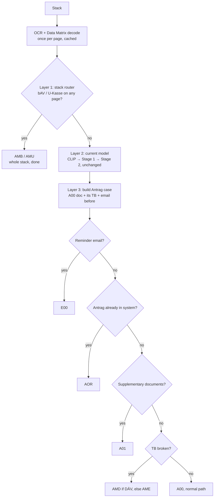

# SST pipeline design for category "Antrag"

> Based only on the facts in `sst_established_facts_en.md`. Status: 23.11.2026.

---

## 1. Goal

When a new stack arrives, the pipeline assigns the correct SST to every document in the stack: A00, G07, MAD and the special SSTs (AMB, AMU, AME, AMD, AOR, E00, A01, LNS, AMW, ...). TB0 pages belong inside A00 documents.

## 2. Design principle

Three facts decide the overall shape:

1. **The special SSTs are defined by the process, not by page content.** Pages of an AME or AMB document look like A00 pages, and their pages are `Bestand/Default` in Snowflake. So **there are no page-level labels to train these SSTs.**
2. **AMB and AMU stacks are never shared with another SST.** For these two, the whole stack is the decision unit.
3. **Mixed stacks exist** (A00 + MAD + AME, or email + AOR + 3 × AME). For all other SSTs the stack must first be split into documents, which is the model's job.

Result: **three layers.** The model stays unchanged; the SST is assigned by rules.

## 3. Tree diagram



Plain-text version:

```
stack
  │
  ▼
OCR + Data Matrix decode (once per page, cached)
  │
  ▼
Layer 1: Stack router (no model)
   bAV / U-Kasse on any page of the stack?
   ├── yes → whole stack = AMB or AMU                                  done
   └── no
        │
        ▼
Layer 2: Current model (CLIP → Stage 1 → Stage 2, unchanged)
   pages → content documents: A00 (with TB0), G07, MAD
        │
        ▼
Layer 3: Build the "Antrag case" and assign the SST
   each predicted A00 document + its TB + the email page before it = one case
   rules in order:
   ├── reminder email?            yes → E00
   ├── Antrag already in system?  yes → AOR
   ├── supplementary documents?   yes → A01
   ├── TB broken?                 yes → AMD (DÄV) / AME
   └── otherwise                       → A00
```

## 4. Execution order per stack

```
render
  → OCR + Data Matrix decode for every page          (each once, cached)
  → Layer 1: on all pages of the stack
       • payload of 103 → kzbAV
       • AXA01 code     → form number
       • regex on OCR   → "Routing: bAV", "Unterstützungskasse"
     ├── AMB / AMU → done
     └── no
  → CLIP → Stage 1 → Stage 2                          (Layer 2)
  → Layer 3: per Antrag case
       • TB broken? DÄV?   ← from the cached decode, only the pages of this case
       • email regex       ← from the same OCR (E00, A01)
       • lookup            ← AOR
```

- Every page is decoded and OCR'd **once**. Layer 1 and Layer 3 use the same results; they only **group** them differently (whole stack vs. pages of one case).
- OCR must run **before** Layer 1, because the regex needs it. OCR is also a model input, so nothing is computed twice.
- CLIP is only needed for Layer 2. It can be computed only for stacks that pass Layer 1, or for all stacks for simplicity (AMB + AMU are about 2 % of stacks).
- Mixed stacks with several Technikblätter: at stack level their chunks get mixed (`conflicting_chunks`) and the 103 payload may not open. This does not matter for Layer 1: the OCR regex gives the bAV signal independently, and AMB stacks are never shared with another SST.

## 5. Signal per SST

| SST | Layer | Signal | Supporting fact |
|---|---|---|---|
| **AMB** | 1 (stack) | `kzbAV` in the 103 payload (e.g. `DIREKT`), or regex on the TB text page ("Routing: bAV", "Durchführungsweg"), or `AXA01` form number | Nina: always AMB. Data: `kzbAV` present in AMB, absent in 201 A00 files. AMB stacks are never shared |
| **AMU** | 1 (stack) | Regex: "Unterstützungskasse" (Durchführungsweg, VN, or heading of the U-Kasse TB layout) | Nina: always AMU. Maral: never shared. Data: some TBs have no Data Matrix |
| **E00** | 3 | Email page (header `Absender:` / `Betreff:`) with a reminder ("erinnern") in subject or body | Nina + process doc: reminder email; the rest is A00 |
| **AOR** | 3 | Barcode of the TB / Antrag already in the system | Process doc: compare barcode, date, amounts |
| **A01** | 3 | Email with "ergänzende Angaben", or a case without an Antrag form (supplementary pages only) | Process doc |
| **AMD** | 3 | TB broken **and** DÄV (`mandantId=DAEV`, or OCR "Gesellschaft: DÄV" / "Deutsche Ärzteversicherung") | Nina: only with a broken TB |
| **AME** | 3 | TB broken, not DÄV | Nina |
| **A00** | 3 | none of the above | |
| **LNS** | **cannot be designed yet** | No fact on how the clerk recognises LNS | Section 10 |
| **AMW** | **cannot be designed yet** | Rule struck out by Nina | Section 10 |

**TB broken** (existing decoder): container 102 or 103 incomplete, or a TB text page is present (`AXA01` with form `D21011325`, `D21011326` or `D21012001`) but no grid page. Same logic as `tbCheckDocClassForContainer`.

**Rule order in Layer 3:**
- E00 and AOR come before AME/AMD: in the AME path the clerk first checks in AMA that the Antrag is not already registered, and E00 is processed "like AOR" (process doc).
- AMB before AOR (process doc) is already guaranteed by Layer 1.
- The order is derived from the process doc and still needs Nina's confirmation.

## 6. Training decision

**No new training is needed.**

| Option | Decision | Reason |
|---|---|---|
| SST as a model class | **No** | No page-level labels (all `Bestand`), and the content equals A00 |
| E00 as a class | **No** | An E00 document = email + A00 pages with one label. Its Antrag pages would get E00 while looking like A00 |
| "Email page" class | **No** | The only label source would be the email-header regex; the model would just copy it |
| U-Kasse TB layout as TB0 | **No** | Only occurs in AMU stacks, which Layer 1 removes before the model |

## 7. Building the "Antrag case" (Layer 3)

The model has never seen some page types (e.g. email pages). It may make them a separate document or attach them to the next one. One simple rule handles this:

- A predicted document that **starts with** an email page (header regex), or **consists only** of an email page, is attached to the **next** A00 document.
- This matches the clerk's behaviour: in the mixed-stack example, the email stayed with the first TB.

**Cannot be decided from the facts:** does an AME or AMD document in a mixed stack also contain G07 or MAD pages (stapled)?
- **No:** case = model's A00 document + email; the design is complete.
- **Yes:** the model splits G07 and MAD into separate documents, so predicted units differ from labelled units, and a merge rule is needed. Its form depends on the answer. Evaluation step 8 answers this.

## 8. Bringing in the new data

| # | Step | Reason |
|---|---|---|
| 1 | **Select from Snowflake** **complete** stacks (all `doc_id`s, including A00/MAD of mixed stacks) with `doc_id`, SST, MID, `image_id`. Suggested size: all AMU (108) and AMW (47); about 300 stacks each of AMB, AME, AMD, AOR, E00, A01, LNS | Layer 1 reads the whole stack and the model segments the whole stack. 300 per SST is enough for precision/recall |
| 2 | **Separate mapping.** `config.pages_csv` does not depend on `batch_id` (`mapping_output / "life_mid_pages.csv"`). Write the mapping output of the new documents to a separate location | Otherwise the next training batch picks them up with `Bestand` labels |
| 3 | **Download and render** with a new `batch_id`, 200 DPI | Same input as production and the model |
| 4 | **Prediction-only prepare:** in `data.py` accept an empty `page_class` (`has_label=False`, `class_target=-100`); skip `assign_splits`; skip the population hash check in `precompute_features` and the features sha check in `load_stage2_checkpoint`; keep the Stage 1 checkpoint sha check | The model runs on non-AMB/AMU stacks; they have no page labels and are not for training |
| 5 | **OCR and CLIP** for the batch | Layers 1 and 3 need OCR; the model needs both |
| 6 | **Predict** with the current checkpoints | Layer 2 |
| 7 | **New code:** Layer 1 (stack-level decode + regex), table "`AXA01` form number → SST" (count forms per SST in this batch), Layer 3 (cases + rules). Reuse the decode functions of `tb_datamatrix_check.py` (`zxing_texts`, `read_chunks`, `payload`, `derived_class`), not its `main` (which groups by `doc_id` or predictions). Reading `kzbAV` from the 103 XML still has to be added | The solution itself |

## 9. Evaluation

| # | Measurement | Data |
|---|---|---|
| 8 | **Units:** for each special `doc_id` in a mixed stack, does one predicted case contain exactly the same pages? (page overlap) | New batch |
| 9 | **SST per document:** precision / recall per SST against the Snowflake label; AMB/AMU at stack level | New batch |
| 10 | **False positives:** run Layers 1 and 3 on the existing A00/G07/MAD batch; every special SST assigned there is an error | Existing batch `antrag_life_A00_G07_MAD` |

Step 10 can run now: OCR and A00 payloads already exist.

## 10. Open questions

| # | Question | Why it matters |
|---|---|---|
| 1 | **How is LNS recognised?** | ~21,000 documents, the largest special SST (larger than all others together), and no fact about its rule. Cannot be designed without Nina |
| 2 | When does AMW apply? | Rule struck out |
| 3 | Is the order E00 → AOR → A01 → AMD/AME correct? | Derived from the process doc, not confirmed by Nina |
| 4 | Late-sent Technikblatt: A01 or AOR? | Got AOR in the mixed-stack example |
| 5 | Access to AMA / PePe for AOR? If not, a barcode index built from our own past documents? | Without it, AOR cannot be detected |
| 6 | Does a special document in a mixed stack also contain G07/MAD pages? | Section 7; answered by evaluation step 8 |
| 7 | Value of `kzbAV` for U-Kasse; how is Riester recorded? | Precision of Layer 1 |
| 8 | AMB stacks with two documents (~3 %): how to split them? | Proposal: treat as one document for now and count as a known error; two different barcodes on two TBs might separate them |

---

**Summary:** the model stays unchanged and no training is needed. AMB and AMU are decided before the model, at stack level. All other SSTs are decided after the model, per "Antrag case", with rules. Question 1 (LNS) is the most important thing to answer before building; question 6 is answered by the first new batch.
