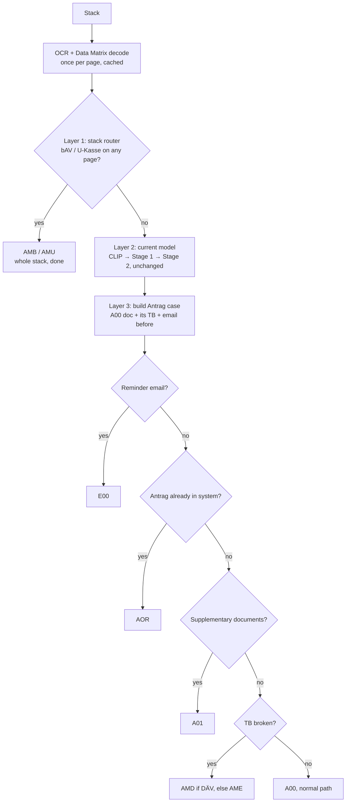

# طراحی ِ pipeline ِ SST برای category ِ «Antrag»

> فقط بر اساس فکت‌های `sst_established_facts_en.md`. وضعیت: ۲۳ نوامبر ۲۰۲۶.

---

## ۱. هدف

وقتی یک stack ِ جدید می‌رسد، pipeline به هر سند ِ داخل آن SST ِ درست را می‌دهد: A00، G07، MAD، و SST های ویژه (AMB، AMU، AME، AMD، AOR، E00، A01، LNS، AMW و غیره). صفحه‌های TB0 داخل سند A00 هستند.

## ۲. اصل طراحی

سه فکت شکل کلی را تعیین می‌کنند:

1. **SST های ویژه در سطح فرایند تعریف می‌شوند، نه محتوا.** صفحه‌های AME یا AMB شبیه A00 هستند و در Snowflake `Bestand/Default` هستند. پس **برچسب ِ صفحه‌ای برای آموزش ِ این SST ها وجود ندارد.**
2. **stack های AMB و AMU با هیچ SST ِ دیگری مشترک نیستند.** برای این دو، کل stack واحد ِ تصمیم است.
3. **stack ِ مشترک وجود دارد** (A00 + MAD + AME، یا ایمیل + AOR + سه AME). برای بقیه‌ی SST ها اول باید stack به سند تقسیم شود، و این کار ِ مدل است.

نتیجه: **سه لایه.** مدل بدون تغییر می‌ماند و SST را قانون‌ها تعیین می‌کنند.

## ۳. نمودار درختی



نسخه‌ی متنی:

```
stack
  │
  ▼
OCR + decode ِ Data Matrix (برای هر صفحه یک بار، cache می‌شود)
  │
  ▼
لایه ۱: Stack router (بدون مدل)
   bAV / U-Kasse در هر صفحه‌ای از stack؟
   ├── بله → کل stack = AMB یا AMU                                    تمام
   └── نه
        │
        ▼
لایه ۲: مدل ِ فعلی (CLIP → Stage 1 → Stage 2، بدون تغییر)
   صفحه‌ها → سندهای محتوایی: A00 (با TB0)، G07، MAD
        │
        ▼
لایه ۳: ساختن ِ «پرونده‌ی Antrag» و دادن SST
   هر سند A00 ِ پیش‌بینی‌شده + TB ِ آن + صفحه‌ی ایمیل ِ قبل از آن = یک پرونده
   قانون‌ها به ترتیب:
   ├── ایمیل ِ یادآوری؟              بله → E00
   ├── Antrag قبلاً در سیستم هست؟    بله → AOR
   ├── مدارک ِ تکمیلی؟               بله → A01
   ├── TB خراب؟                      بله → AMD (DÄV) / AME
   └── در غیر این صورت                    → A00
```

## ۴. ترتیب ِ اجرا برای هر stack

```
render
  → OCR + decode ِ Data Matrix برای هر صفحه        (هر دو یک بار، cache می‌شوند)
  → لایه ۱: روی همه‌ی صفحه‌های stack
       • payload ِ 103 → kzbAV
       • کد ِ AXA01     → شماره‌ی فرم
       • regex روی OCR  → «Routing: bAV»، «Unterstützungskasse»
     ├── AMB / AMU → تمام
     └── نه
  → CLIP → Stage 1 → Stage 2                         (لایه ۲)
  → لایه ۳: برای هر پرونده‌ی Antrag
       • TB خراب؟ DÄV؟   ← از همان decode ِ cache‌شده، فقط صفحه‌های این پرونده
       • regex ِ ایمیل   ← از همان OCR (E00، A01)
       • lookup          ← AOR
```

- هر صفحه فقط **یک بار** decode و OCR می‌شود. لایه ۱ و ۳ از همان نتیجه استفاده می‌کنند و فقط **گروه‌بندی‌شان** فرق می‌کند (کل stack، یا صفحه‌های یک پرونده).
- OCR باید **قبل از** لایه ۱ اجرا شود، چون regex به آن احتیاج دارد. OCR ورودی ِ مدل هم هست، پس چیزی دو بار حساب نمی‌شود.
- CLIP فقط برای لایه ۲ لازم است. می‌شود آن را فقط برای stack هایی ساخت که از لایه ۱ رد می‌شوند، یا برای سادگی برای همه (AMB و AMU حدود ۲٪ ِ stack ها هستند).
- در stack ِ مشترک با چند Technikblatt، chunk ها در سطح stack قاطی می‌شوند (`conflicting_chunks`) و ممکن است payload ِ 103 باز نشود. برای لایه ۱ مشکلی نیست: regex روی OCR سیگنال bAV را جداگانه می‌دهد، و stack های AMB با SST ِ دیگری مشترک نیستند.

## ۵. سیگنال ِ هر SST

| SST | لایه | سیگنال | فکت ِ پشتیبان |
|---|---|---|---|
| **AMB** | ۱ (stack) | `kzbAV` در payload ِ 103 (مثلاً `DIREKT`)، یا regex روی صفحه‌ی متنی ِ TB («Routing: bAV»، «Durchführungsweg»)، یا شماره‌ی فرم ِ `AXA01` | Nina: همیشه AMB. داده: `kzbAV` در AMB هست، در 201 فایل ِ A00 نیست. stack ِ AMB مشترک نیست |
| **AMU** | ۱ (stack) | regex: «Unterstützungskasse» (در Durchführungsweg، VN، یا تیتر ِ TB ِ قالب ِ U-Kasse) | Nina: همیشه AMU. مارال: مشترک نیست. داده: بخشی از TB ها Data Matrix ندارند |
| **E00** | ۳ | صفحه‌ی ایمیل (سربرگ `Absender:` / `Betreff:`) با یادآوری («erinnern») در موضوع یا متن | Nina و سند فرایند: ایمیل ِ یادآوری. بقیه‌اش A00 است |
| **AOR** | ۳ | Barcode ِ TB یا Antrag قبلاً در سیستم هست | سند فرایند: مقایسه‌ی Barcode، تاریخ و مبالغ |
| **A01** | ۳ | ایمیل با «ergänzende Angaben»، یا پرونده‌ای بدون فرم Antrag (فقط صفحه‌های تکمیلی) | سند فرایند |
| **AMD** | ۳ | TB خراب **و** DÄV (`mandantId=DAEV`، یا OCR: «Gesellschaft: DÄV» / «Deutsche Ärzteversicherung») | Nina: فقط با TB ِ خراب |
| **AME** | ۳ | TB خراب، DÄV نیست | Nina |
| **A00** | ۳ | هیچ‌کدام | |
| **LNS** | **هنوز قابل طراحی نیست** | هیچ فکتی درباره‌ی اینکه کارمند LNS را از کجا تشخیص می‌دهد نداریم | بخش ۱۰ |
| **AMW** | **هنوز قابل طراحی نیست** | قانون را Nina خط زده | بخش ۱۰ |

**«TB خراب»** با decoder ِ موجود: container ِ 102 یا 103 ناقص است، یا صفحه‌ی متنی ِ TB هست (`AXA01` با فرم `D21011325`، `D21011326` یا `D21012001`) ولی صفحه‌ی grid نیست. همان منطق ِ `tbCheckDocClassForContainer`.

**ترتیب ِ قانون‌ها در لایه ۳:**
- E00 و AOR قبل از AME و AMD می‌آیند: در مسیر ِ AME کارمند اول در AMA چک می‌کند که Antrag ثبت نشده باشد، و E00 «مثل AOR» پردازش می‌شود (سند فرایند).
- AMB قبل از AOR (سند فرایند) با لایه ۱ از قبل تضمین شده است.
- این ترتیب از سند فرایند استخراج شده و هنوز باید Nina تأییدش کند.

## ۶. تصمیم درباره‌ی training

**هیچ training ِ جدیدی لازم نیست.**

| گزینه | تصمیم | دلیل |
|---|---|---|
| SST به‌عنوان کلاس ِ مدل | **نه** | برچسب ِ صفحه نداریم (همه `Bestand`)، و محتوا با A00 یکی است |
| E00 به‌عنوان کلاس | **نه** | سند E00 = ایمیل + صفحه‌های A00 با یک برچسب. صفحه‌های Antrag ِ داخلش برچسب E00 می‌گیرند، در حالی که شکل A00 دارند |
| کلاس ِ «صفحه‌ی ایمیل» | **نه** | تنها منبع ِ برچسب regex ِ سربرگ ایمیل است، و مدل فقط آن را تقلید می‌کند |
| TB ِ قالب ِ U-Kasse به‌عنوان TB0 | **نه** | فقط در stack های AMU هست، و لایه ۱ آن‌ها را قبل از مدل جدا می‌کند |

## ۷. ساختن ِ «پرونده‌ی Antrag» (لایه ۳)

مدل بعضی صفحه‌ها (مثل صفحه‌ی ایمیل) را هرگز ندیده است. ممکن است آن‌ها را سند ِ جدا کند یا به سند ِ بعدی بچسباند. یک قانون ِ ساده این را حل می‌کند:

- سند ِ پیش‌بینی‌شده‌ای که **با** صفحه‌ی ایمیل شروع می‌شود (regex ِ سربرگ)، یا **فقط** صفحه‌ی ایمیل است، به سند A00 ِ **بعدی** وصل می‌شود.
- این با رفتار ِ کارمند جور است: در مثال ِ stack ِ مشترک، ایمیل به TB ِ اول چسبیده بود.

**از فکت‌ها قابل تصمیم نیست:** آیا سند AME یا AMD در stack ِ مشترک صفحه‌های G07 یا MAD را هم داخل خودش دارد (منگنه‌شده)؟
- **اگر نه:** پرونده = سند A00 ِ مدل + ایمیل، و طراحی کامل است.
- **اگر بله:** مدل G07 و MAD را سند ِ جدا می‌کند، واحد ِ پیش‌بینی با واحد ِ برچسب یکی نمی‌شود، و یک قانون ِ ادغام لازم است. شکل ِ آن قانون به جواب بستگی دارد. مرحله‌ی ۸ ِ ارزیابی این را جواب می‌دهد.

## ۸. ورود ِ داده‌ی جدید

| # | مرحله | چرا |
|---|---|---|
| ۱ | **انتخاب از Snowflake.** stack های **کامل** (همه‌ی `doc_id` ها، حتی A00 و MAD ِ stack ِ مشترک)، با `doc_id`، SST، MID و `image_id`. حجم پیشنهادی: همه‌ی AMU (108) و AMW (47)، و حدود ۳۰۰ stack از هر یک از AMB، AME، AMD، AOR، E00، A01 و LNS | لایه ۱ کل stack را می‌خواند و مدل کل stack را segment می‌کند. ۳۰۰ برای precision و recall کافی است |
| ۲ | **mapping ِ جدا.** `config.pages_csv` به `batch_id` بستگی ندارد (`mapping_output / "life_mid_pages.csv"`). خروجی ِ mapping ِ سندهای جدید در مسیر ِ جدا نوشته شود | وگرنه batch ِ آموزشی ِ بعدی آن‌ها را با برچسب ِ `Bestand` برمی‌دارد |
| ۳ | **دانلود و رندر** با `batch_id` ِ جدید، ۲۰۰ DPI | همان ورودی ِ پروداکشن و مدل |
| ۴ | **prepare ِ prediction-only:** در `data.py` `page_class` ِ خالی پذیرفته شود (`has_label=False`، `class_target=-100`). `assign_splits` اجرا نشود. چک ِ population hash در `precompute_features` و چک ِ features sha در `load_stage2_checkpoint` رد شوند. چک ِ sha ِ checkpoint ِ Stage 1 بماند | مدل روی stack های غیر AMB و AMU اجرا می‌شود. این‌ها برچسب ِ صفحه ندارند و برای آموزش نیستند |
| ۵ | **OCR و CLIP** برای batch | لایه ۱ و ۳ OCR لازم دارند، و مدل هر دو را |
| ۶ | **predict** با checkpoint های فعلی | لایه ۲ |
| ۷ | **کد ِ جدید:** لایه ۱ (decode در سطح stack + regex)، جدول ِ «شماره‌ی فرم ِ `AXA01` → SST» (شمارش ِ فرم‌ها در هر SST از همین batch)، لایه ۳ (پرونده‌ها + قانون‌ها). از توابع ِ decode ِ `tb_datamatrix_check.py` استفاده شود (`zxing_texts`، `read_chunks`، `payload`، `derived_class`)، نه از `main` ِ آن (که با `doc_id` یا predictions گروه می‌کند). خواندن ِ `kzbAV` از XML ِ 103 هنوز باید اضافه شود | خود ِ راه‌حل |

## ۹. ارزیابی

| # | سنجش | داده |
|---|---|---|
| ۸ | **واحدها:** برای هر `doc_id` ِ ویژه در stack ِ مشترک، آیا یک پرونده‌ی پیش‌بینی‌شده دقیقاً همان صفحه‌ها را دارد؟ (همپوشانی ِ صفحه‌ها) | batch ِ جدید |
| ۹ | **SST برای هر سند:** precision و recall برای هر SST با برچسب ِ Snowflake. AMB و AMU در سطح stack | batch ِ جدید |
| ۱۰ | **مثبت ِ کاذب:** لایه ۱ و ۳ روی batch ِ موجود ِ A00/G07/MAD. هر SST ِ ویژه‌ای که آنجا داده شود، خطاست | batch ِ موجود `antrag_life_A00_G07_MAD` |

مرحله‌ی ۱۰ همین الان قابل اجراست، چون OCR و payload های A00 آماده‌اند.

## ۱۰. سؤال‌های باز

| # | سؤال | چرا مهم است |
|---|---|---|
| ۱ | **LNS از کجا تشخیص داده می‌شود؟** | حدود ۲۱ هزار سند، بزرگ‌ترین SST ِ ویژه (از همه‌ی بقیه با هم بزرگ‌تر)، و هیچ فکتی درباره‌ی قانونش نداریم. بدون Nina قابل طراحی نیست |
| ۲ | AMW کِی؟ | قانون خط خورده |
| ۳ | ترتیب ِ E00 → AOR → A01 → AMD/AME درست است؟ | از سند فرایند استخراج شده، Nina تأیید نکرده |
| ۴ | TB ِ بعداً فرستاده‌شده: A01 یا AOR؟ | در مثال ِ stack ِ مشترک AOR گرفت |
| ۵ | دسترسی به AMA / PePe برای AOR هست؟ اگر نه، یک index ِ Barcode از سندهای ِ قبلی ِ خودمان؟ | بدون این، AOR تشخیص داده نمی‌شود |
| ۶ | سند ِ ویژه در stack ِ مشترک صفحه‌های G07 یا MAD را هم دارد؟ | بخش ۷. با مرحله‌ی ۸ جواب داده می‌شود |
| ۷ | `kzbAV` برای U-Kasse چه مقداری دارد؟ Riester چطور ثبت می‌شود؟ | دقت ِ لایه ۱ |
| ۸ | stack های AMB با دو سند (حدود ۳٪): چطور جدا شوند؟ | پیشنهاد: فعلاً یک سند حساب شوند و به‌عنوان خطای ِ شناخته‌شده شمرده شوند. شاید دو Barcode ِ متفاوت روی دو TB جدایشان کند |

---

**خلاصه:** مدل دست نمی‌خورد و training لازم نیست. AMB و AMU قبل از مدل، در سطح stack تعیین می‌شوند. بقیه بعد از مدل، روی «پرونده‌ی Antrag»، با قانون. سؤال ۱ (LNS) مهم‌ترین چیزی است که باید قبل از ساختن جواب بگیرد، و سؤال ۶ با اولین batch ِ جدید جواب داده می‌شود.
